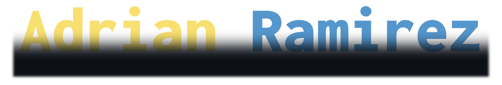
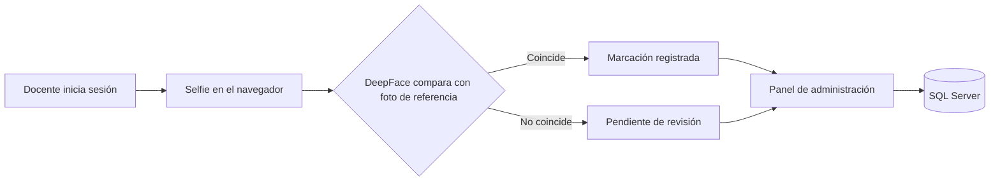

Construyo sistemas web con **Python, Node.js y ASP.NET**: del backend y la base de datos a la interfaz.

[Proyectos](#-proyectos-destacados) · [Stack](#-stack-tecnológico) · [Trabajo actual](#-en-lo-que-trabajo-ahora) · [Otros repos](#-más-repositorios)

---

## 👋 Sobre mí

- 🧩 Desarrollo **backend y frontend** de aplicaciones web completas: autenticación, paneles de administración, reportes y bases de datos relacionales.
- 🔬 Me interesa la **visión por computador aplicada** (verificación facial), la automatización y el *web scraping*.
- 📚 Siempre aprendiendo: cursos de Python, Java y criptografía.

## 🚀 En lo que trabajo ahora

> **[`sistema_marcacion_docente`](https://github.com/adrianrmz11/sistema_marcacion_docente)**: marcación de asistencia docente con verificación facial.
>
> Los docentes ingresan con usuario y clave y validan su identidad con una **selfie** que se compara contra su foto de referencia usando **DeepFace**. Un panel de administración permite revisar, aprobar o rechazar marcaciones, con los datos en **SQL Server**.

## 📂 Proyectos destacados

| Proyecto | Descripción | Stack |
|---|---|---|
| 🧑‍🏫 [**sistema_marcacion_docente**](https://github.com/adrianrmz11/sistema_marcacion_docente) | Asistencia docente con verificación facial y panel de administración. |    |
| 🌱 [**EcoYvyApp**](https://github.com/adrianrmz11/EcoYvyApp) | Aplicación web full stack con backend en Python y frontend propio. |    |
| 🎫 [**soporte_ticket**](https://github.com/adrianrmz11/soporte_ticket) | Sistema de tickets de soporte, con instalación en un solo comando. |    |
| 🏦 [**web_cooperativa**](https://github.com/adrianrmz11/web_cooperativa) | Sitio de cooperativa para *Base de Datos I y II*, con Node.js y XAMPP. |    |
| 🛠️ [**sgppies**](https://github.com/adrianrmz11/sgppies) | Proyecto de *Ingeniería de Software / Ingeniería Avanzada de Software*. |   |

## 🧰 Stack tecnológico

**Lenguajes**

**Backend y frameworks**

**Datos, herramientas y entorno**

<b>Ver detalle por área</b>

| Área | Tecnologías |
|---|---|
| **Backend** | Python (Flask, ReportLab), Node.js (Express), ASP.NET |
| **Frontend** | HTML, CSS, JavaScript |
| **Datos** | SQL Server, MySQL (XAMPP) |
| **IA / Visión** | DeepFace (verificación facial) |
| **Otros** | Web scraping con Python, Java (CRUD), C++, bots de Discord |

## 🗂️ Más repositorios

| Repo | Qué es |
|---|---|
| [`curso-python-evaluacion`](https://github.com/adrianrmz11/curso-python-evaluacion) | Evaluación de curso: *web scraping* con Python. |
| [`python_seminario`](https://github.com/adrianrmz11/python_seminario) | Material del curso de Python. |
| [`cursojava_crud`](https://github.com/adrianrmz11/cursojava_crud) | CRUD en Java. |
| [`timestamper`](https://github.com/adrianrmz11/timestamper) | Convierte timestamps en tiempo relativo (Node.js). |
| [`PianoFromAbove`](https://github.com/adrianrmz11/PianoFromAbove) | Mod para Piano From Above (C++). |
| [`Nosoy`](https://github.com/adrianrmz11/Nosoy) · [`gBot`](https://github.com/adrianrmz11/gBot) | Bots de Discord (JavaScript), proyectos antiguos. |

## 📊 Estadísticas

